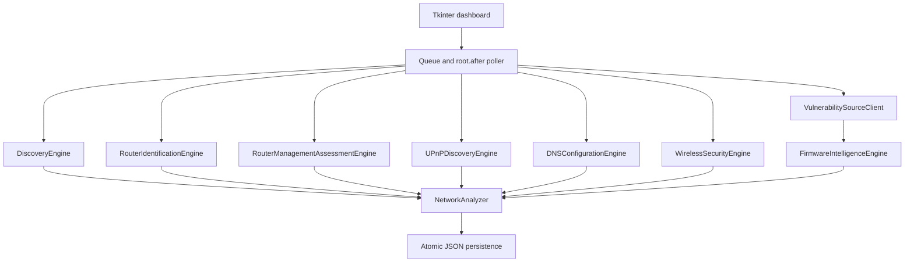

# NetGuard Bangladesh

## Intelligent Network & Wi-Fi Security Monitoring Platform

**Discover. Monitor. Detect. Investigate. Protect.**

NetGuard Bangladesh is an evidence-driven Windows network security monitoring
application for individuals, IT administrators, NGOs, educational institutions,
and businesses. It combines local network observations, router assessment,
wireless intelligence, and public vulnerability information while keeping
uncertainty visible.

> **Current status: Experimental / conditional phase releases.**  
> NetGuard is not an antivirus replacement, enterprise EDR, commercial firewall,
> or guarantee of attack prevention.

## Project overview

NetGuard helps administrators understand what a Windows host can actually
observe on an authorized local network. It distinguishes ARP-cache evidence from
active ICMP reachability, records historical changes, assesses the selected
gateway with bounded read-only checks, and provides conservative UPnP, DNS,
Wi-Fi, and router firmware intelligence.

The project prioritizes defensible evidence over simulated telemetry. Unknown
devices are not treated as malicious, mapping changes are not confirmed as ARP
spoofing, and a missing vulnerability record is not treated as proof of safety.

## Key features

### Network discovery

- Windows interface and IPv4 subnet discovery.
- Explicitly authorized private/link-local IPv4 discovery.
- Windows ARP-cache observation and historical device inventory.
- Cancellable, bounded ICMP probing.
- Conservative duplicate and mapping-change anomalies.

ARP-cache presence does not prove that a device is online, safe, connected now,
or that the complete network has been discovered.

### Router security

- Selected-interface gateway identification.
- Read-only local gateway TCP service assessment.
- Minimal HTTP observations without credentials or redirect following.
- TLS certificate and handshake observations.
- No exploitation, brute forcing, credential attempts, or configuration changes.

### UPnP and DNS

- Authorized IPv4 SSDP discovery.
- Local device-description parsing with size and XML safety limits.
- Windows DNS configuration observation.
- Consent-based UDP A/AAAA resolver checks and comparisons.

IPv6 SSDP, DNSSEC, DoH, DoT, and DoQ are not implemented.

### Wi-Fi intelligence

- Windows `netsh wlan` adapter and driver observations.
- Current connection and nearby SSID/BSSID observations.
- Authentication, cipher, signal, and channel classification.
- Local wireless baseline management.
- Informational indicators for new BSSIDs, open networks, and weaker security.

These indicators do not confirm a rogue access point, evil twin, interception,
or compromise. Client-mode output is not monitor-mode packet capture.

### Firmware intelligence

- Explicit router product and firmware registration.
- User-provided versus user-confirmed identity states.
- NVD CVE 2.0 retrieval with caching, pagination, retries, and rate limiting.
- CPE configuration-tree and version-range evaluation.
- CISA KEV prioritization after product applicability.
- Validated official manufacturer advisory records.
- Read-only firmware update recommendations.

Firmware intelligence is conditional on exact product evidence and source
freshness. It does not download, upload, or install firmware.

## Architecture

The current application remains a single Tkinter entry point with tested
service-style engines inside the module:



Workers collect evidence and publish immutable results through `queue.Queue`.
Only the Tkinter main thread updates widgets. See
[ARCHITECTURE.md](docs/ARCHITECTURE.md) for phase boundaries.

## Technology stack

- Python 3.10+ language features; local verification was performed with
  Python 3.14.5.
- Tkinter for the Windows desktop UI.
- Python standard library for Windows commands, sockets, HTTPS, JSON, XML, and
  concurrency.
- Optional NumPy, Matplotlib, and scikit-learn integrations are detected at
  runtime and are not required for the deterministic test suite.
- Ruff is used as an optional development static-analysis tool.

## Installation

Windows is the supported runtime platform.

```powershell
git clone <repository-url>
cd netguard_Bangladesh
py -3.14 -m venv .venv
.\.venv\Scripts\Activate.ps1
python -m pip install --upgrade pip
python -m pip install -r requirements-dev.txt
```

The core application has no mandatory third-party runtime dependency. Optional
chart or machine-learning packages may be installed separately if desired:

```powershell
python -m pip install numpy matplotlib scikit-learn
```

Start the application:

```powershell
python netguard_bangladesh.py
```

Npcap is not required for the implemented metadata, ICMP, ARP, SSDP, DNS, or
`netsh wlan` paths. Packet capture and monitor-mode Wi-Fi capabilities are not
implemented.

## Usage

1. Launch NetGuard.
2. Select the intended Windows network interface.
3. Review the displayed subnet and authorize active discovery only when allowed.
4. Identify the gateway from local interface and ARP evidence.
5. Authorize a read-only gateway service assessment if appropriate.
6. Authorize UPnP discovery or DNS resolver checks separately.
7. Inspect Wi-Fi observations and create a baseline only after review.
8. Register an exact router model and firmware before synchronizing NVD/KEV data.
9. Review historical device, wireless, router, and firmware assessments.
10. Interpret every finding with its evidence, confidence, and limitations.

## Security and privacy

- Assess only networks and devices you are authorized to inspect.
- Active actions require explicit user consent.
- No password brute forcing, exploitation, or automatic blocking.
- No automatic router configuration or firmware modification.
- Public intelligence synchronization sends only a product search term.
- Router credentials, private addresses, MAC addresses, and configurations are
  not sent to NVD or CISA.
- API keys are read from environment configuration and are not persisted.
- Findings preserve source evidence and remain conservative when data is
  incomplete or stale.

Read [SECURITY_AUDIT.md](docs/SECURITY_AUDIT.md) before deployment.

## Current limitations

- Windows is the supported runtime platform.
- ARP and ICMP do not guarantee complete device discovery.
- IPv6 neighbor discovery and DHCP evidence are not implemented.
- IPv6 SSDP, DNSSEC, DoH, DoT, and DoQ are not implemented.
- Wi-Fi output is client-mode metadata, not packet capture.
- Rogue AP and evil-twin indicators are not confirmations.
- Firmware coverage depends on exact model, hardware, region, and version
  evidence; no-match is not proof of safety.
- No live router or vulnerability validation was performed in this workspace.
- The application remains a monolithic Tkinter module with JSON persistence.

## Roadmap

See [ROADMAP.md](docs/ROADMAP.md) and
[FEATURE_STATUS.md](docs/FEATURE_STATUS.md). Phase reports record conditional
acceptance boundaries rather than claiming universal support.

## Testing

```powershell
python -m unittest discover -s tests -v
python -m py_compile netguard_bangladesh.py tests\test_discovery_engine.py tests\test_runtime_probes.py
```

The latest local run executed **80 tests with 80 passing**. Tests use controlled
fixtures and mocks; they do not require internet access or a real network.

## Contributing

Read [CONTRIBUTING.md](CONTRIBUTING.md) before opening a change. New network
behavior requires deterministic tests, explicit authorization boundaries,
documentation updates, and evidence-preserving error handling.

## License

No `LICENSE` file is currently present. A license decision by the project owner
is required before describing this repository as open source.

## Disclaimer

NetGuard is defensive assessment and monitoring software. It cannot guarantee
complete visibility, vulnerability detection, or protection from cyberattacks.
Use it only within your authority and verify important findings through
official device, network, and manufacturer records.
